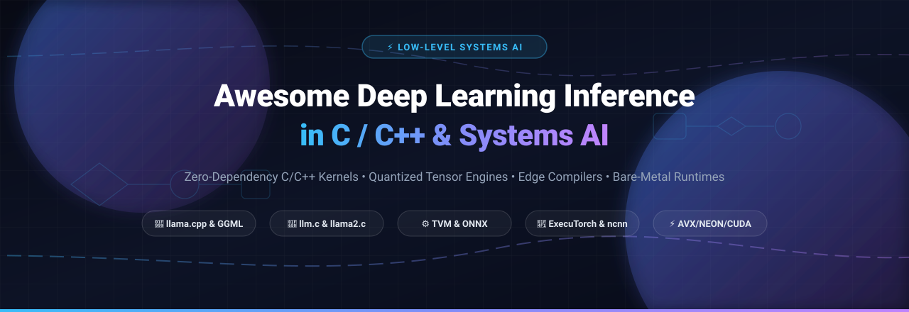

# 🚀 Awesome Deep Learning Inference in C & Systems AI

  

  
  
  
  
  
  

---

## ⚡ Top Deep Learning Inference in C & Systems AI Ecosystem

> **A Curated Directory of SaaS & Hosted Platforms and Production Open-Source Systems AI Projects**  
> *Targeted at Zero-Dependency C/C++ LLM Runtimes, Quantized Tensor Engines, High-Throughput CUDA/C++ Kernels, Edge/Embedded Compilers, and Low-Level Systems AI Engineering.*  
> **Last updated: November 2026**

Deep learning inference is rapidly transitioning from heavyweight Python runtimes toward **bare-metal C/C++ systems engineering**. This repository tracks leading **SaaS/hosted platforms** and **open-source GitHub projects** that compile, quantize, schedule, and execute deep learning neural networks and Large Language Models (LLMs) with minimal memory footprint, deterministic allocation, and zero Python overhead.

Whether you are hacking single-file educational C engines (`llm.c`, `llama2.c`, `kimi-k3-in-c`), benchmarking enterprise C++ inference servers (`llama.cpp`, `vLLM`, `TensorRT-LLM`, `SGLang`), or deploying on microcontrollers and NPUs (`ExecuTorch`, `LiteRT`, `ncnn`, `MNN`, `CMSIS-NN`), this curated ecosystem guide delivers the essential tools and architectural blueprints.

---

## 📑 Table of Contents

- [📊 Sector Overview & Market Dynamics](#-sector-overview--market-dynamics)
- [☁️ SaaS / Hosted Platforms](#️-saas--hosted-platforms)
- [💻 Open-Source GitHub Projects](#-open-source-github-projects)
  - [Top Open-Source Systems & Runtimes (Sorted by Stars)](#top-open-source-systems--runtimes-sorted-by-stars)
- [🛠️ How to Contribute](#️-how-to-contribute)
- [💖 Support & Share](#-support--share)
- [📈 Star History](#-star-history)
- [⚠️ Disclaimer](#️-disclaimer)

---

## 📊 Sector Overview & Market Dynamics

The global deep learning inference and systems AI market is estimated at **$113B–$132B in 2026** and projected to surpass **$350B–$400B by 2030** (~18–28% CAGR) as production LLM and edge workloads eclipse training compute demand. The sector exhibits a **barbell concentration profile**: the foundational infrastructure and accelerator layer is **highly concentrated** (dominated by NVIDIA and hyper-scale cloud providers), while the edge runtime, model-compiler, and specialized serverless inference ecosystem remains **moderately fragmented** with intense competition among custom ASIC startups and open-source-native runtimes.

---

## ☁️ SaaS / Hosted Platforms

| Platform | Valuation / Market Cap / Revenue | Pricing (Starting Tier) | Free Tier Limits | Description |
| :--- | :--- | :--- | :--- | :--- |
| **[Apple Xcode Cloud & CoreML Services](https://apple.com)** | ~$3.6T – $3.8T MCap | **$49.99/mo** for 100 compute hours ($99.99/mo for 250 hrs, up to $3,999.99/mo for 10k hrs) | **25 compute hours/month** included permanently with standard $99/year Apple Developer membership | Managed build, automated testing, and Neural Engine profiling infrastructure for compiling and benchmarking CoreML models across iOS, macOS, and visionOS devices. |
| **[NVIDIA NIM & TensorRT Cloud](https://nvidia.com)** | ~$3.5T – $4.0T MCap | **$1.00/GPU-hour** on cloud marketplaces or **$4,500/GPU/year** via NVIDIA AI Enterprise production license | **90-day free evaluation trial** of NVIDIA AI Enterprise; free testing endpoints on `build.nvidia.com` playground | Managed cloud inference microservices and TensorRT compilation services delivering ultra-low-latency FP8/FP4/INT4 C++ engine optimization on NVIDIA GPUs. |
| **[ONNX Runtime Cloud / Azure ML Managed Endpoints](https://onnxruntime.ai)** | ~$3.1T – $3.2T MCap (Microsoft) | **$0.096/hour** starting VM compute rate (e.g. `Standard_DS2_v2` CPU node) | **30-day free trial** with **$200 Azure credit** (no always-free dedicated endpoint tier) | Managed cloud deployment and hardware-accelerated execution provider hosting for production ONNX C/C++ inference pipelines. |
| **[Qualcomm AI Hub](https://qualcomm.com)** | ~$170B – $185B MCap | **$0.00 (Free developer access)**; production edge volume licensing on custom quote | **Free forever plan** with access to hosted device farm (real Snapdragon phones, IoT, and XR devices) for model profiling, quantizing, and compiling | Cloud model optimization, quantization, and hardware-profiling platform enabling developers to compile and benchmark models directly on hosted Snapdragon mobile, IoT, and automotive devices. |
| **[Intel Tiber Developer Cloud (OpenVINO Cloud)](https://intel.com)** | ~$85B – $90B MCap | **$0.06/hour** starting compute rate for paid instances (Standard paid tier) | **Free forever Standard account** with access to shared Jupyter notebook environments, 4th/5th Gen Xeon & Arc GPUs, pre-configured OpenVINO sandboxes, subject to session idle timeouts | Cloud hardware testing and model-optimization sandbox for benchmarking C++ OpenVINO inference across Intel Xeon CPUs, Arc GPUs, and Core Ultra NPUs. |
| **[Together AI (Hosted C++/Silicon Runtimes)](https://together.ai)** | ~$8.3B Valuation | **$0.14 per 1M input tokens / $0.28 per 1M output tokens** (serverless starting rate; $15 minimum initial account deposit) | **None (No free tier or trial)**; prepaid platform requiring a **$15 initial deposit** to access serverless endpoints | High-throughput serverless inference cloud running custom C++/CUDA FlashAttention, speculative decoding, and quantized tensor kernels at scale. |
| **[llama.cpp & GGML Managed Cloud Workers (RunPod)](https://runpod.io)** | ~$1.0B Valuation | **$0.0002/second** (~$0.20/hour for community GPU instances; serverless billed per second) | **No permanent free tier**; promotional sign-up trial credit of **$25 (valid for first-time verified accounts)** | Serverless GPU and CPU cloud platforms offering pre-built GGUF / `llama.cpp` C++ inference containers with instant API scaling. |
| **[OctoAI / CentML & TVM Cloud Acceleration](https://apache.org)** | ~$400M Valuation (Acquired by NVIDIA) | **$1.00 per 1M tokens / dynamic credit-based pay-as-you-go** ($1/credit) | **14-day free trial** with **$10 in platform credits** upon registration | Cloud ML compiler and kernel auto-tuning services built around Apache TVM to generate hardware-specific C++/CUDA/Metal inference runtimes. |
| **[Edge Impulse](https://edgeimpulse.com)** | ~$234M Valuation (Acquired by Qualcomm) | **$39.00/seat/month** starting tier (Enterprise custom licensing for >1,000 commercial units) | **Developer Plan (Free forever)**: **3 private projects**, unlimited public projects, **3 collaborators/project**, and **60 min/job compute time** with 16 GB RAM | Cloud embedded ML platform compiling sensor, audio, and vision models into zero-dependency ANSI C++ libraries for microcontrollers and DSPs. |

---

## 💻 Open-Source GitHub Projects

Below is a comprehensive list of production, educational, and experimental C/C++ deep learning and systems AI engines. Each project features a real-time star badge (style: `social`, color: `white`) linking directly to the repository's stargazers page, ordered in **descending star count**.

### Top Open-Source Systems & Runtimes (Sorted by Stars)

1. **[llama.cpp](https://github.com/ggml-org/llama.cpp)**   
   *Flagship open-source LLM inference engine in pure C/C++ with zero dependencies, supporting GGUF 1.5-bit to 8-bit quantization, AVX/NEON SIMD, CUDA, Metal, Vulkan, and ROCm.*

2. **[vLLM](https://github.com/vllm-project/vllm)**   
   *High-throughput and memory-efficient LLM serving engine featuring PagedAttention, continuous batching, custom C++/CUDA kernels, and speculative decoding.*

3. **[whisper.cpp](https://github.com/ggml-org/whisper.cpp)**   
   *High-performance, zero-dependency C/C++ implementation of OpenAI's Whisper speech-to-text model with 16-bit and 4-bit quantization on CPUs and GPUs.*

4. **[SGLang](https://github.com/sgl-project/sglang)**   
   *Fast serving framework for large language models and vision-language models with RadixAttention for automatic KV cache reuse and optimized C++/CUDA runtime.*

5. **[tinygrad](https://github.com/tinygrad/tinygrad)**   
   *Minimalist deep learning framework and compiler lowering neural nets into bare-metal C, LLVM, Metal, OpenCL, and CUDA with zero bloat.*

6. **[llm.c](https://github.com/karpathy/llm.c)**   
   *LLM training and inference in simple, raw, dependency-free C and CUDA by Andrej Karpathy designed for maximum systems-level readability and raw hardware speed.*

7. **[Darknet](https://github.com/pjreddie/darknet)**   
   *Legendary open-source neural network framework written in pure C and CUDA powering real-time YOLO object detection and computer vision.*

8. **[FlashAttention](https://github.com/Dao-AILab/flash-attention)**   
   *Fast, memory-efficient exact attention C++/CUDA implementation utilizing GPU SRAM tiling to eliminate IO bottlenecks in modern transformer architectures.*

9. **[ncnn](https://github.com/Tencent/ncnn)**   
   *High-performance neural network inference computing framework optimized for mobile platforms, ARM NEON SIMD assembly, and Vulkan GPU acceleration.*

10. **[ONNX Runtime](https://github.com/microsoft/onnxruntime)**   
    *Cross-platform, high-performance C/C++ scoring and inference engine supporting extensive execution providers including TensorRT, OpenVINO, DirectML, and CoreML.*

11. **[llama2.c](https://github.com/karpathy/llama2.c)**   
    *Single-file (~700 lines) pure-C implementation for running Llama 2/3 architecture inference anywhere—from microcontrollers to multi-core CPUs with OpenMP.*

12. **[MNN](https://github.com/alibaba/MNN)**   
    *Blazing-fast, lightweight deep learning inference engine battle-tested in Alibaba mobile apps, supporting multi-backend execution on CPU, GPU, and NPU.*

13. **[ggml](https://github.com/ggml-org/ggml)**   
    *Foundational tensor library written in C/C++ powering `llama.cpp`, optimized for integer quantization (Q4_0, Q4_K, Q8_0) and cross-platform CPU/GPU/NPU execution.*

14. **[TensorRT-LLM](https://github.com/NVIDIA/TensorRT-LLM)**   
    *NVIDIA's specialized C++ inference orchestration runtime providing state-of-the-art FP8/INT4 quantization and in-flight batching on modern NVIDIA GPUs.*

15. **[Apache TVM](https://github.com/apache/tvm)**   
    *Open-source machine learning compiler framework in C++ that lowers high-level neural graphs directly into bare-metal C, LLVM, CUDA, Metal, and WebGPU.*

16. **[kimi-k3-in-c](https://github.com/FareedKhan-dev/kimi-k3-in-c)**   
    *Open-source pure-C implementation running inference on a 2.78-trillion-parameter Kimi K3 MoE architecture on a single node without external dependencies.*

17. **[OpenVINO](https://github.com/openvinotoolkit/openvino)**   
    *Intel's comprehensive open-source C++ toolkit for optimizing, quantizing (`NNCF`), and accelerating deep learning inference across x86/ARM CPUs, GPUs, and NPUs.*

18. **[CUTLASS](https://github.com/NVIDIA/cutlass)**   
    *Collection of CUDA C++ template abstractions for implementing high-performance matrix-multiplication (GEMM) and deep learning primitives at all levels of GPU hierarchy.*

19. **[ExecuTorch](https://github.com/pytorch/executorch)**   
    *Meta's official on-device AI runtime written in C++ for executing PyTorch models natively across mobile devices, embedded systems, and microcontrollers.*

20. **[IREE](https://github.com/iree-org/iree)**   
    *Retargetable MLIR-based machine learning compiler and runtime lowering dynamic neural models to efficient native code for CPUs, GPUs, and custom accelerators.*

21. **[LiteRT (formerly TF Lite)](https://github.com/google-ai-edge/LiteRT)**   
    *Google's on-device C++ inference runtime successor to TensorFlow Lite, engineered with XNNPACK SIMD acceleration and hardware delegates for edge NPUs.*

22. **[TensorFlow Lite Micro](https://github.com/tensorflow/tflite-micro)**   
    *Open-source C++ neural network inference runtime engineered specifically for microcontrollers and DSPs with only a few kilobytes of memory.*

23. **[Arm NN](https://github.com/ARM-software/armnn)**   
    *Official open-source C++ inference engine translating neural network graphs into optimized primitives for Arm Cortex-A CPUs, Mali GPUs, and Ethos NPUs.*

24. **[calm](https://github.com/zeux/calm)**   
    *Ultra-fast, self-contained C++ language model inference engine supporting Qwen, Llama, and Mistral models with clean, minimal CUDA/Metal and CPU kernels.*

25. **[CMSIS-NN](https://github.com/ARM-software/CMSIS-NN)**   
    *Collection of efficient neural network kernels written in C with Arm Helium (MVE) and SIMD instructions for Cortex-M processors.*

---

## 🛠️ How to Contribute

Contributions are warmly welcomed! Help keep this systems AI ecosystem directory up to date:

1. **Fork the repository** on GitHub.
2. **Add or edit entries** in `README.md` maintaining table formatting, pricing transparency, and accurate star badges.
3. Ensure descriptions are concise, technical, and link directly to official repositories or project sites.
4. **Submit a Pull Request** with a clear explanation of the addition.

---

## 💖 Support & Share

If you find this curated list valuable for your systems AI research, compiler hacking, or low-level engineering work, please consider supporting the project:

- ⭐ **Star this repository** to increase visibility and help developers discover low-level C inference engines.
- 🍴 **Fork & Share** with your colleagues, lab members, and developer communities on X/Twitter, LinkedIn, and Reddit.
- ☕ **Support the creator** — You can sponsor or buy a coffee via the [GitHub Sponsor Dashboard](https://github.com/sponsors/ishandutta2007) with support tiers for profile badges, repository shoutouts, and priority feature requests!

---

## 📈 Star History

---

## ⚠️ Disclaimer

- This is an independent, community-driven curated resource and is not affiliated with or endorsed by any company or foundation listed.
- Low-level C and C++ inference engines manipulate raw memory pointers, `mmap` tensor files directly, and schedule low-level GPU kernels. Always verify model binary checksums (SHA-256) and exercise memory bounds checking when evaluating third-party weights or GGUF files.

---

  <b>Built for Systems AI Engineers, Embedded ML Developers, C/C++ Kernel Hackers, and Open-Source Builders.</b> 
  Let's make deep learning inference in C and systems AI more open, lightweight, and hardware-efficient.

